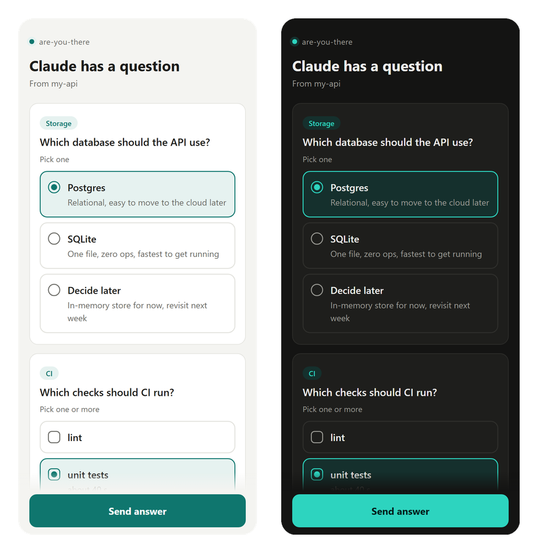

# are-you-there (在吗)

[中文](README.zh-CN.md)

Claude Code asks you a question and waits. You left for coffee twenty minutes ago.

**are-you-there** is a Claude Code plugin that checks whether you're actually there before Claude waits on you:

- **At the terminal**: nothing changes.
- **At the computer, another window focused**: a desktop notification so you notice the question.
- **Away**: the question goes to your phone. Tap an answer and Claude carries on. If you get back to the terminal first, the question is waiting there as usual.

It also tells Claude where you are, pushes "Claude finished" and "Claude needs permission" only when you're away (not every turn), and can let Claude pick the safest reversible option when nobody answers.

No server to run, no account, no dependencies beyond Python's standard library.

<p align="center"></p>

## How it works

```
Claude calls AskUserQuestion
        │
  PreToolUse hook: reads system idle time and the focused window
        │
        ├─ at the terminal ──────► ask as usual
        ├─ elsewhere on the PC ──► ask as usual + desktop notification
        └─ away ─────────────────► push to your phone
                                     ├─ you tap an answer ──► the hook fills it in, Claude continues
                                     ├─ you return to the terminal first ──► ask as usual
                                     └─ no answer in 30 min ──► ask as usual, or let Claude decide
```

Presence comes from two OS signals: how long since the last keyboard or mouse input anywhere on the system, and which app has focus. If the focused window belongs to the terminal running Claude Code (found by walking the process tree, with a list of known terminals and editors as a fallback), you're at the terminal. A locked screen counts as away right away.

Answering from the phone uses a Claude Code hook feature: a `PreToolUse` hook may fill in `AskUserQuestion`'s `answers` through `updatedInput`, and the question is then answered without a dialog. Each question gets a one-time random [ntfy](https://ntfy.sh) topic and a nonce; the hook listens on that topic and accepts only an answer with the right nonce whose value is one of the offered options.

Questions have an expiry time. The answer page distinguishes sending to the relay from confirmation by the computer, and shows when a question has expired or moved back to the terminal. If confirmation cannot be retrieved, it says so instead of claiming Claude continued.

## Install

```
/plugin marketplace add Dreamistic/are-you-there
/plugin install are-you-there@are-you-there
```

Then run `/are-you-there:setup`. Claude walks you through picking a channel, generates a private topic, and sends a test question to your phone.

Requirements:

- Python 3.8 or newer on `PATH` (standard library only)
- A recent Claude Code (developed on 2.1.299; older versions may reject the plugin)
- On Windows, Git Bash, which Claude Code already uses to run hooks

<details>
<summary>Manual install, without the plugin system</summary>

Clone the repo anywhere and add this to `~/.claude/settings.json`, replacing `/path/to/are-you-there`:

```json
{
  "hooks": {
    "PreToolUse": [
      { "matcher": "AskUserQuestion",
        "hooks": [{ "type": "command", "command": "sh \"/path/to/are-you-there/scripts/run.sh\" pre-ask", "timeout": 7200 }] }
    ],
    "Stop": [
      { "hooks": [{ "type": "command", "command": "sh \"/path/to/are-you-there/scripts/run.sh\" stop", "timeout": 30 }] }
    ],
    "Notification": [
      { "matcher": "permission_prompt|elicitation_dialog",
        "hooks": [{ "type": "command", "command": "sh \"/path/to/are-you-there/scripts/run.sh\" notification", "timeout": 30 }] }
    ]
  }
}
```

Put your settings in `~/.claude/are-you-there.json` (see [config.example.json](config.example.json)), then check with `sh /path/to/are-you-there/scripts/run.sh test --ask`.
</details>

## Channels

| Channel | Platforms | Answer from the phone |
| --- | --- | --- |
| [ntfy](https://ntfy.sh) (recommended) | Android, iOS, desktop | One-tap buttons for a single question with up to 3 options; the answer page for everything else |
| [Bark](https://github.com/Finb/Bark) | iOS | Tap the notification to open the answer page |
| Webhook: Slack, Discord, Feishu, DingTalk, WeCom, ServerChan, plain JSON | wherever those apps run | Open the link in the message |

Answers always travel back through a one-time ntfy topic (on `ntfy.sh` unless you set `relay_server`), so every channel can answer, not just ntfy. You can configure several channels at once.

Discord uses an embed for long answer links. Links longer than 4,096 characters count as a failed delivery; if every configured channel fails, the question returns to the terminal.

Authenticated relays require an explicit `relay_token` on the computer; `ntfy_token` is not reused. The token never appears in answer links or notification buttons. On the phone, open the page and enter a relay credential that can read and write the answer topic; the page does not save it. Native one-tap buttons are available only for anonymous relays. Use a dedicated, restricted relay account rather than an administrator credential.

The [answer page](docs/answer.html) is a single static HTML file served from GitHub Pages. The question reaches it in the URL fragment (`#...`), which browsers never send to the server, so GitHub never sees your questions.

## Configuration

Set options in `/config` (plugin options) or in `~/.claude/are-you-there.json`. Plugin options win over the file; blank plugin options fall back to it.

| Key | Default | Meaning |
| --- | --- | --- |
| `ntfy_topic` | | Your private ntfy topic. Make it unguessable: `run.sh new-topic` prints one |
| `ntfy_server` | `https://ntfy.sh` | ntfy server, if you self-host |
| `ntfy_token` | | Access token for servers that require auth |
| `bark_url` | | `https://api.day.app/<key>` |
| `webhook_url` | | Bot URL |
| `webhook_format` | `json` | `json`, `slack`, `discord`, `feishu`, `dingtalk`, `wecom`, `serverchan` |
| `away_minutes` | `3` | No input this long while another app has focus means away |
| `reading_minutes` | `5` | Same, while the terminal has focus (reading a long answer isn't leaving) |
| `answer_timeout_minutes` | `30` | How long a question waits for a phone answer (max 110) |
| `when_no_answer` | `ask` | After a delivered question times out on a reachable relay: `ask` waits in the terminal; `decide` lets Claude pick the safest reversible option. Missing channels, failed delivery, and detected relay failures always return to the terminal |
| `language` | `auto` | `auto`, `en`, `zh`. Auto follows Claude Code's `language` setting, then the system locale |
| `phone_answer` | `true` | Send an answer link and buttons, and wait for the reply. `false` makes phone pushes one-way |
| `allow_free_text` | `false` | Accept typed answers from the phone, not only the offered options |
| `share_app_name` | `true` | Tell Claude which app has focus when you're elsewhere |
| `desktop_notify` | `true` | Desktop notification when you're elsewhere: native Windows notifications, OSC 9 in supporting terminals on other platforms |
| `notify_on_stop` | `true` | Push when Claude finishes while you're away |
| `notify_on_permission` | `true` | Push when Claude waits on a permission prompt while you're away |
| `terminal_apps` | `[]` | Extra process names that count as the terminal |
| `relay_server` | `ntfy_server` | Where phone answers and computer receipts travel |
| `relay_token` | | Computer-side relay credential, configured separately; never included in notifications or links |
| `answer_page` | GitHub Pages | Host your own copy of `docs/answer.html` and point here |

Environment variables `ARE_YOU_THERE_<KEY>` override everything, which is handy for testing.

## Platform support

| Platform | Status | Signals |
| --- | --- | --- |
| Windows 10/11 | Works, tested | `GetLastInputInfo`, foreground window, lock screen (LockApp) |
| macOS | Beta: written, not yet tested on real hardware | `ioreg` HIDIdleTime, `lsappinfo` front app, screen lock |
| Linux, X11 | Experimental | `xprintidle`, `xdotool`, `loginctl` lock |
| Linux, GNOME on Wayland | Experimental | Mutter IdleMonitor; which window has focus is unknown |
| SSH, containers, WSL | The plugin stays quiet | Input happens on another machine, so it can't tell |

Run `sh scripts/run.sh watch` to see what it detects, live. Reports from macOS and Linux users are very welcome.

## Privacy and security

- Nothing leaves your computer unless you are away and a channel is configured.
- The question text goes to the channel you picked. Use a self-hosted ntfy server if that matters.
- The relay carries the chosen option, a nonce, and question status receipts on a random topic used once. Expired answers are rejected by the computer.
- Long-lived relay credentials stay out of notifications and links. Authenticated phone pages request a credential explicitly and do not save it.
- By default the hook accepts only the offered option labels, so a forged reply can't inject instructions into your agent. Turn on `allow_free_text` only with a private relay.
- Your ntfy topic name is effectively a password. Keep it random.
- When you're elsewhere, Claude is told which app has focus. Set `share_app_name` to `false` if you'd rather not.

## Development

Publish `docs/answer.html` alongside plugin updates: the current links use protocol v2. Older links are rejected by the updated page, and older pages cannot open v2 links. If you host your own answer page, update that copy too.

```
python -m unittest discover -s tests      # unit tests with a mock ntfy server, no network
python tests/e2e_claude.py                 # real Claude Code end to end (costs a few cents)
sh scripts/run.sh status                   # what the plugin sees right now
```

## Roadmap

- Approve permission prompts and plans (`ExitPlanMode`) from the phone
- Treat meetings and Do Not Disturb as away (microphone or camera in use, Focus Assist)
- WSL support through Windows interop
- Two-way Telegram

## Acknowledgments

- [ntfy](https://github.com/binwiederhier/ntfy) by Philipp C. Heckel: the push service and relay that make answers possible without running a server.
- [clauding-afk](https://github.com/fomyio/clauding-afk): approving permission requests from the phone through a one-time ntfy response topic. The relay here follows the same idea.
- [claude-idle-alert](https://claudeissues.com/issue/66469-plugin-submission-claude-idle-alert): escalating reminders through Feishu and DingTalk, which showed that teams in China want this too.
- [uthere](https://www.remoteopenclaw.com/mcp/odfalik/uthere): presence detection for Claude Code with a webcam. This plugin uses input idle time instead.
- [Bark](https://github.com/Finb/Bark) by Fin.

No code was copied from these projects; the credit is for ideas.

## License

[MIT](LICENSE)
