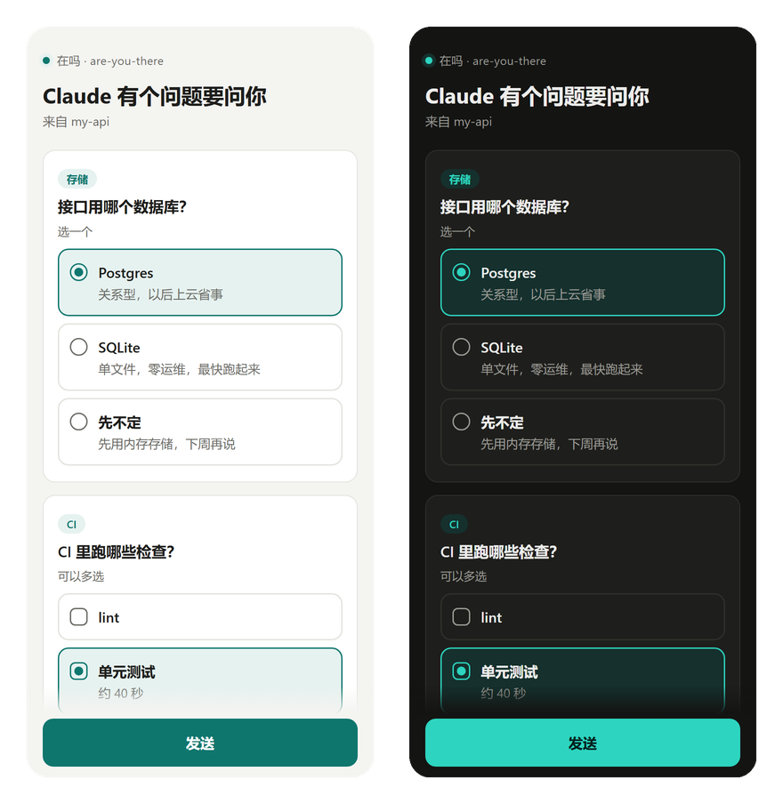

# 在吗（are-you-there）

[English](README.md)

Claude Code 问了你一个问题，然后干等着。你二十分钟前就去倒水了。

**在吗**是一个 Claude Code 插件。Claude 要等你之前，先看看你到底在不在：

- **在终端前**：什么都不变。
- **在电脑前，但焦点在别的窗口**：弹一条桌面通知，免得你错过问题。
- **人不在**：问题推到手机上，点一下答案，Claude 接着干。你要是先回到了终端，问题照常在终端里等你。

它还会把你在哪儿告诉 Claude；「Claude 做完了」「Claude 要权限」这两种推送，只在你不在的时候发，不是每轮都发；没人回答的时候，可以让 Claude 自己选最稳妥、能撤回的那条路。

不用跑服务器，不用注册账号，除了 Python 标准库什么都不依赖。

<p align="center"></p>

## 怎么做到的

```
Claude 调用 AskUserQuestion
        │
  PreToolUse hook：读系统空闲时间和当前焦点窗口
        │
        ├─ 在终端前 ────────► 照常提问
        ├─ 在电脑前、焦点在别处 ─► 照常提问 + 桌面通知
        └─ 人不在 ──────────► 推到手机
                                ├─ 你在手机上点了答案 ──► hook 把答案填进去，Claude 继续
                                ├─ 你先回到了终端 ──► 照常提问
                                └─ 30 分钟没回 ──► 照常提问，或者让 Claude 自己定
```

在不在看两个系统信号：整台电脑上一次键盘鼠标输入是多久以前，以及哪个应用拿着焦点。焦点窗口如果属于正在跑 Claude Code 的那个终端（顺着进程树往上找，找不到再对照常见终端和编辑器的名单），就算你在终端前。锁屏直接算不在。

手机作答用的是 Claude Code 的一个 hook 能力：`PreToolUse` hook 可以通过 `updatedInput` 把 `AskUserQuestion` 的 `answers` 填上，这个问题就算答完了，不再弹窗。每个问题配一个一次性的随机 [ntfy](https://ntfy.sh) topic 和一个 nonce，hook 在这个 topic 上听着，只收 nonce 对得上、值又是给出的选项之一的答案。

每道题都有有效期。答题页会区分「已发送到中继」和「电脑已接收」，并提示问题已过期或已转回终端。收不到电脑确认时会明确显示未确认，不会直接宣称 Claude 已经继续。

## 安装

```
/plugin marketplace add Dreamistic/are-you-there
/plugin install are-you-there@are-you-there
```

装好后运行 `/are-you-there:setup`。Claude 会带你选推送渠道、生成私有 topic，再往你手机上发一道测试题。

需要：

- `PATH` 里有 Python 3.8 以上（只用标准库）
- 较新的 Claude Code（开发时用的是 2.1.299，太老的版本可能加载不了插件）
- Windows 上要有 Git Bash，Claude Code 本来就用它跑 hook

<details>
<summary>手动安装，不走插件系统</summary>

把仓库克隆到任意位置，在 `~/.claude/settings.json` 里加上下面这段，`/path/to/are-you-there` 换成你的路径：

```json
{
  "hooks": {
    "PreToolUse": [
      { "matcher": "AskUserQuestion",
        "hooks": [{ "type": "command", "command": "sh \"/path/to/are-you-there/scripts/run.sh\" pre-ask", "timeout": 7200 }] }
    ],
    "Stop": [
      { "hooks": [{ "type": "command", "command": "sh \"/path/to/are-you-there/scripts/run.sh\" stop", "timeout": 30 }] }
    ],
    "Notification": [
      { "matcher": "permission_prompt|elicitation_dialog",
        "hooks": [{ "type": "command", "command": "sh \"/path/to/are-you-there/scripts/run.sh\" notification", "timeout": 30 }] }
    ]
  }
}
```

配置写在 `~/.claude/are-you-there.json`（参考 [config.example.json](config.example.json)），然后用 `sh /path/to/are-you-there/scripts/run.sh test --ask` 试一下。
</details>

## 推送渠道

| 渠道 | 平台 | 能不能在手机上答 |
| --- | --- | --- |
| [ntfy](https://ntfy.sh)（推荐） | 安卓、iOS、桌面 | 单个问题、选项不超过 3 个时，通知上直接有按钮；其余情况点开答题页 |
| [Bark](https://github.com/Finb/Bark) | iOS | 点通知打开答题页 |
| Webhook：飞书、钉钉、企业微信、Server 酱、Slack、Discord、通用 JSON | 这些应用能跑的地方 | 点消息里的链接 |

答案一律经一次性的 ntfy topic 传回来（默认走 `ntfy.sh`，可以用 `relay_server` 换掉），所以不管问题是哪个渠道送到的，都能答，不只是 ntfy。几个渠道可以同时开。

Discord 的长答题链接会放进嵌入消息。链接超过 4,096 个字符时算发送失败；如果所有已配置渠道都失败，问题会回到终端。

鉴权中继需要在电脑端单独配置 `relay_token`，不再复用 `ntfy_token`。令牌不会放进答题链接或通知按钮；手机端打开答题页后，手工输入可读写答题主题的中继凭据，页面不会保存它。匿名中继仍可使用通知上的一键按钮。建议使用专用受限中继账户，避免使用管理员凭据。

[答题页](docs/answer.html)是一个放在 GitHub Pages 上的静态 HTML。问题内容放在网址的 `#` 后面，浏览器从来不把这一段发给服务器，GitHub 看不到你的问题。

## 配置

在 `/config` 的插件选项里改，或者写进 `~/.claude/are-you-there.json`。两边都有时插件选项优先，插件选项留空就用文件里的。

| 键 | 默认 | 含义 |
| --- | --- | --- |
| `ntfy_topic` | | 你的私有 ntfy topic，要难猜：`run.sh new-topic` 能生成一个 |
| `ntfy_server` | `https://ntfy.sh` | 自建 ntfy 时填你的地址 |
| `ntfy_token` | | 服务器要求鉴权时的 token |
| `bark_url` | | `https://api.day.app/<key>` |
| `webhook_url` | | 机器人地址 |
| `webhook_format` | `json` | `json`、`slack`、`discord`、`feishu`、`dingtalk`、`wecom`、`serverchan` |
| `away_minutes` | `3` | 焦点在别的应用、键鼠闲置这么久，算离开 |
| `reading_minutes` | `5` | 焦点在终端时的离开时长。盯着一大段回答看，不算走开 |
| `answer_timeout_minutes` | `30` | 问题在手机上等多久（最多 110） |
| `when_no_answer` | `ask` | 仅在成功送达、中继可连通且等待超时后生效：`ask` 回终端等待；`decide` 让 Claude 选最稳妥、能撤回的路。未配渠道、发送失败或已检测到中继故障，一律回终端 |
| `language` | `auto` | `auto`、`en`、`zh`。auto 先看 Claude Code 的 `language` 设置，再看系统语言 |
| `phone_answer` | `true` | 推送里带答题链接和按钮，并等回复。设成 `false` 就只推不收 |
| `allow_free_text` | `false` | 允许在手机上手写答案，不只是点选项 |
| `share_app_name` | `true` | 你在别的窗口时，告诉 Claude 焦点在哪个应用 |
| `desktop_notify` | `true` | 你在别的窗口时弹桌面通知：Windows 使用系统通知，其他平台通过支持 OSC 9 的终端发送 |
| `notify_on_stop` | `true` | 你不在时，Claude 做完一轮推一条 |
| `notify_on_permission` | `true` | 你不在时，Claude 卡在权限确认上推一条 |
| `terminal_apps` | `[]` | 额外算作「终端」的进程名 |
| `relay_server` | 同 `ntfy_server` | 手机答案和电脑确认走哪个中继 |
| `relay_token` | 空 | 电脑端中继凭据，需单独配置，不随通知或链接发送 |
| `answer_page` | GitHub Pages | 想自己托管 `docs/answer.html` 就改这里 |

环境变量 `ARE_YOU_THERE_<键名大写>` 优先级最高，测试时好用。

## 平台支持

| 平台 | 状态 | 用到的信号 |
| --- | --- | --- |
| Windows 10/11 | 可用，测过 | `GetLastInputInfo`、前台窗口、锁屏（LockApp） |
| macOS | Beta：写好了，还没在真机上测 | `ioreg` HIDIdleTime、`lsappinfo` 前台应用、锁屏 |
| Linux X11 | 实验性 | `xprintidle`、`xdotool`、`loginctl` 锁屏 |
| Linux GNOME Wayland | 实验性 | Mutter IdleMonitor，拿不到焦点窗口 |
| SSH、容器、WSL | 插件不出声 | 键盘在另一台机器上，判断不了 |

想实时看它认出了什么，跑 `sh scripts/run.sh watch`。很欢迎 macOS 和 Linux 用户反馈。

## 隐私与安全

- 你不在、并且配了渠道，才会有东西离开你的电脑。
- 问题内容会发到你选的渠道。介意的话自建 ntfy。
- 中继传输选项、nonce 和问题状态确认，topic 随机生成、只用一次；过期答案会被电脑拒绝。
- 长期中继凭据不会随通知或链接传播；鉴权答题页要求手工输入凭据，不会保存。
- 默认只收给出的选项标签，伪造的回复没法往你的 agent 里塞指令。中继是你自己的时候，再考虑打开 `allow_free_text`。
- ntfy topic 的名字就相当于密码，保持随机。
- 你在别的窗口时，Claude 会知道焦点在哪个应用。不想让它知道，把 `share_app_name` 设成 `false`。

## 开发

插件更新时需要同步发布 `docs/answer.html`：当前链接使用 v2 协议，更新后的答题页会拒绝旧链接，旧答题页也无法打开 v2 链接。自托管答题页也需要一起更新。

```
python -m unittest discover -s tests      # 单元测试，自带假 ntfy 服务器，不联网
python tests/e2e_claude.py                 # 拿真 Claude Code 跑端到端（花几美分）
sh scripts/run.sh status                   # 插件此刻看到了什么
```

## 路线图

- 在手机上批权限、批计划（`ExitPlanMode`）
- 开会和勿扰模式算不在（麦克风或摄像头占用、专注助手）
- 通过 Windows 互操作支持 WSL
- Telegram 双向

## 致谢

- [ntfy](https://github.com/binwiederhier/ntfy)，作者 Philipp C. Heckel：推送和中继都靠它，不用自己跑服务器就能收答案。
- [clauding-afk](https://github.com/fomyio/clauding-afk)：在手机上批权限，用一次性的 ntfy 回复 topic 传结果。这里的中继沿用了同样的思路。
- [claude-idle-alert](https://claudeissues.com/issue/66469-plugin-submission-claude-idle-alert)：用飞书、钉钉逐级催人，说明国内团队也需要这个。
- [uthere](https://www.remoteopenclaw.com/mcp/odfalik/uthere)：用摄像头判断你在不在。这个插件改用键鼠闲置时间。
- [Bark](https://github.com/Finb/Bark)，作者 Fin。

没有从这些项目复制代码，致谢的是思路。

## 协议

[MIT](LICENSE)
